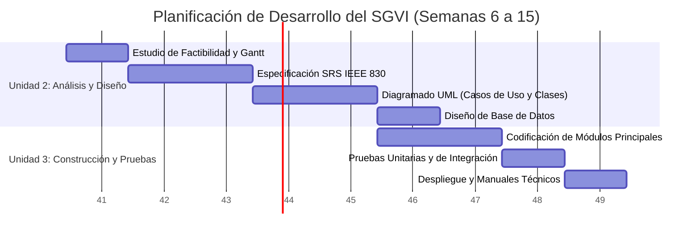

# Cronograma de Trabajo y Diagrama de Gantt - SGVI

**Proyecto:** Sistema de Gestión de Ventas e Inventario  
**Periodo:** Semanas 6 a 15 de 2026  
**Responsable:** Cristian Maldonado

## 1. Desglose de Trabajo (WBS)

| Código | Actividad | Entregable |
|---|---|---|
| 1.1 | Estudio de factibilidad | FACTIBILIDAD.md |
| 1.2 | Especificación de requisitos | SRS_IEEE830.md |
| 1.3 | Modelado UML de casos de uso y clases | Diagramas UML |
| 1.4 | Diseño de la base de datos | Modelo de datos |
| 2.1 | Codificación de módulos principales | Módulos del SGVI |
| 2.2 | Pruebas unitarias y de integración | Evidencias de pruebas |
| 2.3 | Despliegue y documentación técnica | Sistema y manuales |

## 2. Diagrama de Gantt

## 3. Matriz de Asignación de Responsabilidades (RACI)

Como el proyecto se desarrolla individualmente, una sola persona asume las responsabilidades de ejecución, aprobación y seguimiento. No se asignan responsabilidades ficticias a otros integrantes.

| Tarea / Fase | Cristian Maldonado |
|---|---|
| Factibilidad y SRS | Responsable (R), Aprobador (A) |
| Modelado UML | Responsable (R), Aprobador (A) |
| Diseño de Base de Datos | Responsable (R), Aprobador (A) |
| Codificación | Responsable (R), Aprobador (A) |
| Pruebas y documentación | Responsable (R), Aprobador (A) |

**Nota:** La matriz se adapta al trabajo individual. No sustituye una revisión independiente cuando esta sea requerida.
