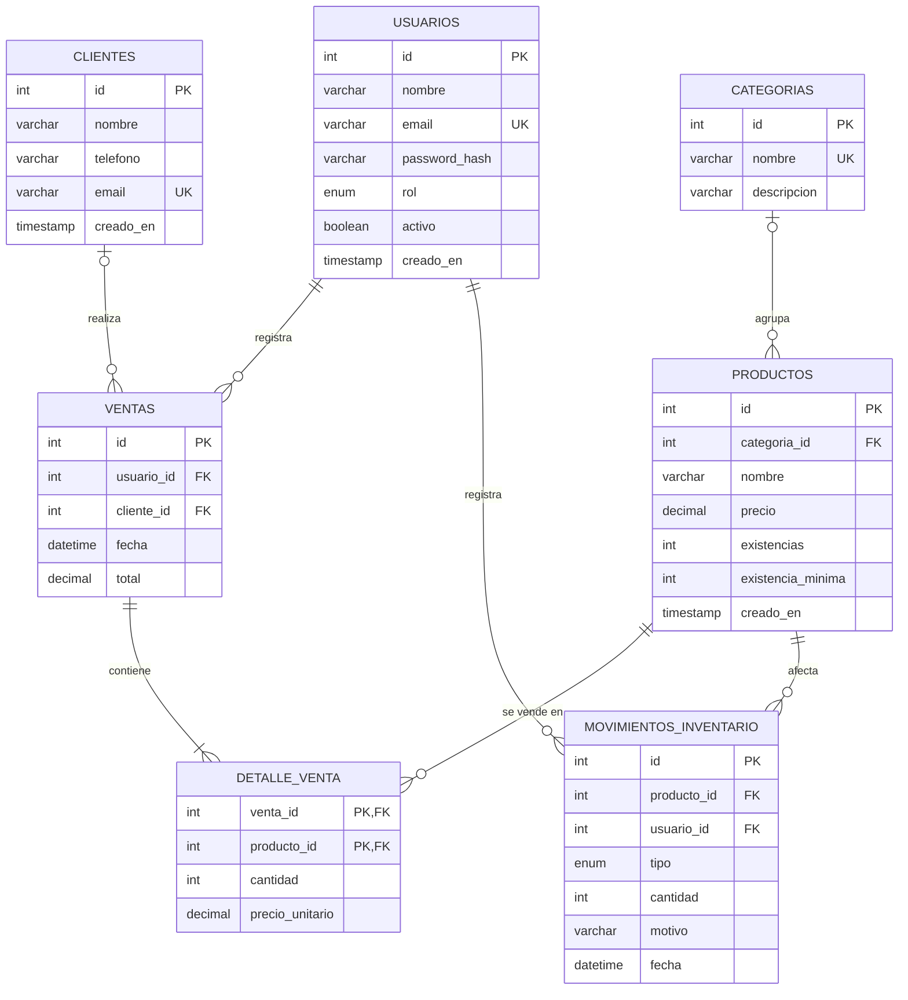

# Diseño de la Base de Datos

**Proyecto:** Sistema de Gestión de Ventas e Inventario (SGVI)  
**Motor:** MySQL 8 (modelo relacional) | **Script DDL:** `database/schema.sql`  
**Responsable:** Cristian Maldonado | **Fecha:** 2026-11-08

## 1. Modelo conceptual: Diagrama Entidad-Relación



## 2. Modelo lógico y normalización

- **Primera forma normal (1FN):** todos los atributos son atómicos; los productos de una venta no se guardan como lista, sino como filas de `detalle_venta`.
- **Segunda forma normal (2FN):** en `detalle_venta`, cuya llave es compuesta (`venta_id`, `producto_id`), los atributos `cantidad` y `precio_unitario` dependen de la llave completa.
- **Tercera forma normal (3FN):** no hay dependencias transitivas; el nombre de la categoría vive en `categorias` y el del cliente en `clientes`. `precio_unitario` se guarda en el detalle a propósito, porque es el precio histórico del momento de la venta y no debe cambiar si después cambia el precio del producto.

## 3. Integridad referencial

| Llave foránea | Acción al eliminar | Justificación |
| :--- | :--- | :--- |
| `detalle_venta.venta_id` → `ventas.id` | `ON DELETE CASCADE` | Composición: si se elimina una venta, sus detalles no tienen sentido por sí solos. |
| `detalle_venta.producto_id` → `productos.id` | `ON DELETE RESTRICT` | No se puede eliminar un producto con ventas registradas, para conservar el historial. |
| `productos.categoria_id` → `categorias.id` | `ON DELETE SET NULL` | Agregación: el producto sigue existiendo aunque se elimine su categoría. |
| `ventas.cliente_id` → `clientes.id` | `ON DELETE SET NULL` | La venta se conserva aunque se dé de baja al cliente. |
| `ventas.usuario_id` → `usuarios.id` | `ON DELETE RESTRICT` | Se conserva quién registró cada venta (los usuarios se desactivan con `activo = FALSE`). |
| `movimientos_inventario.*` | `ON DELETE RESTRICT` | La bitácora de inventario no debe perderse. |

## 4. Restricciones de dominio

- `CHECK (existencias >= 0)` en `productos` impide existencias negativas (RNF-04).
- `CHECK (cantidad > 0)` en `detalle_venta` y `movimientos_inventario` rechaza cantidades inválidas (RF-06, HU-05).
- `CHECK (precio > 0)` y `CHECK (total >= 0)` validan los importes.
- `UNIQUE` en `usuarios.email`, `clientes.email` y `categorias.nombre` evita duplicados.

## 5. Ejecución del script

```bash
mysql -u root -p < database/schema.sql
```
