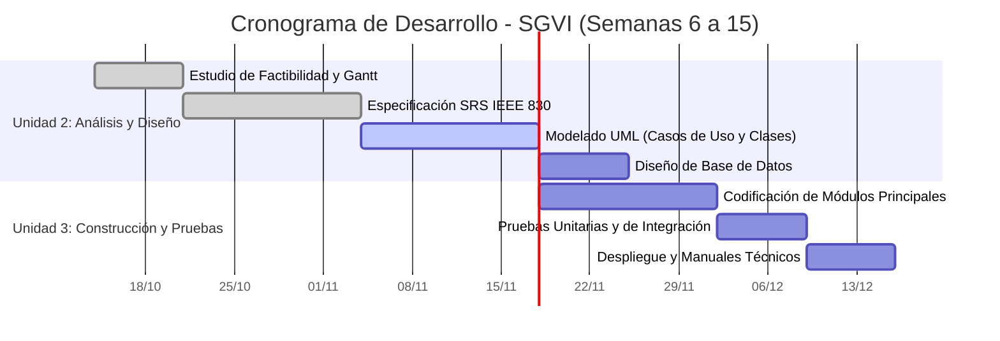

# Estudio de Factibilidad y Planificación del Proyecto

**Proyecto:** Sistema de Gestión de Ventas e Inventario (SGVI)  
**Unidad 2:** Análisis y diseño de sistemas de software de aplicaciones  
**Integrantes:** Cristian Maldonado (desarrollo individual) | **Fecha:** 2026-11-08

> Este documento consolida para el portafolio de la Unidad 2 el estudio de `FACTIBILIDAD.md` y la planificación de `CRONOGRAMA.md` (Práctica 6), y los complementa con la estimación de horas-hombre y el cumplimiento de la LFPDPPP.

## 1. Análisis de Factibilidad Multidimensional

### 1.1 Factibilidad Técnica

| Elemento | Selección | Justificación |
|---|---|---|
| Lenguaje | Python 3 | Conocido por el responsable; amplio soporte de librerías para datos y reportes. |
| Framework web | Flask | Ligero, adecuado para una aplicación web de tamaño mediano con módulos independientes. |
| Interfaz | HTML, CSS y JavaScript | Tecnologías estándar del navegador, sin licencias. |
| Base de datos | MySQL 8 (Community Edition) | Motor relacional gratuito con soporte de llaves foráneas, transacciones y restricciones `CHECK`. |
| Calidad | Flake8 y pruebas unitarias | Definidos en `CALIDAD.md` y `PARADIGMA.md`. |
| Control de versiones | Git y GitHub | Ya configurados y en uso desde la Práctica 1. |

- **Experiencia y capacidades:** el responsable cuenta con formación académica en programación con Python, bases de datos y control de versiones. El trabajo individual limita la capacidad para desarrollar y verificar tareas en paralelo.
- **Riesgos tecnológicos:** errores en la lógica de ventas e inventario, inconsistencia de existencias, problemas de integración entre módulos y limitaciones de tiempo. Se mitigan con validaciones, transacciones en la base de datos, pruebas y el control de cambios descrito en `docs/RIESGOS.md`.
- **Conclusión técnica:** factible. Todas las tecnologías son maduras, gratuitas y compatibles entre sí.

### 1.2 Factibilidad Económica

**Infraestructura y licencias:**

| Recurso | Costo estimado |
|---|---|
| Computadora y conexión a internet (existentes) | $0 MXN adicionales |
| Visual Studio Code, Git, Python, Flask, MySQL Community | $0 MXN (software libre o gratuito) |
| GitHub (repositorio público) | $0 MXN |
| Servidor en la nube | No requerido en el alcance inicial; el sistema se ejecuta en un equipo local |

**Estimación de horas-hombre** (con base en las duraciones del diagrama de Gantt de la sección 2):

| Fase | Días calendario | Horas por día | Horas estimadas |
|---|---:|---:|---:|
| Unidad 2: Análisis y diseño | 42 | 2 | 84 |
| Unidad 3: Construcción y pruebas | 28 | 2 | 56 |
| **Total** | **70** | | **140** |

**Costo de desarrollo de referencia:** 140 horas × $150 MXN por hora = **$21,000 MXN**.

> La tarifa de $150 MXN por hora es un supuesto académico de referencia para un desarrollador en formación; puede ajustarse sin cambiar la fórmula (horas estimadas × costo por hora). No representa un gasto real, porque el proyecto se desarrolla como actividad académica.

- **Análisis de costo-beneficio:** el costo monetario directo es nulo y el costo de referencia corresponde al tiempo del responsable. El beneficio esperado es reducir los errores del registro manual, conocer las existencias en tiempo real y contar con reportes para decidir compras, además del valor académico del proyecto.
- **Conclusión económica:** factible.

### 1.3 Factibilidad Operativa

- **Grado de adopción:** el SGVI reemplaza registros manuales o dispersos por un sistema centralizado. Las funciones siguen las tareas diarias del negocio (vender, registrar productos, revisar existencias), lo que facilita su adopción.
- **Usabilidad:** formularios con etiquetas claras, validaciones de captura y mensajes de error comprensibles (ver RNF de usabilidad en `SRS_IEEE830.md`).
- **Cumplimiento legal (LFPDPPP):** los datos personales de clientes se limitan a los necesarios para identificar sus compras (nombre, teléfono y correo), se protegen con control de acceso por rol y no se comparten con terceros. El sistema mostrará un aviso de privacidad conforme a la Ley Federal de Protección de Datos Personales en Posesión de los Particulares. No se almacenan credenciales en el repositorio y se respetan las licencias de las dependencias de código abierto.
- **Resistencia al cambio:** se mitigará con una interfaz sencilla, una guía de uso y la incorporación gradual de módulos (entregas incrementales).
- **Conclusión operativa:** factible.

## 2. Cronograma de Trabajo y Diagrama de Gantt (Sintaxis Mermaid)

### 2.1 Estructura de Desglose del Trabajo (WBS)

| Código | Actividad | Entregable |
|---|---|---|
| 1.1 | Estudio de factibilidad | `FACTIBILIDAD_PLANIFICACION.md` |
| 1.2 | Especificación de requisitos | `SRS_IEEE830.md` |
| 1.3 | Modelado UML de comportamiento y estructura | `SRS_IEEE830.md` (casos de uso y secuencia), `MODELADO_UML.md` |
| 1.4 | Diseño de la base de datos | `DISEÑO_BD.md`, `database/schema.sql` |
| 2.1 | Codificación de módulos principales | Módulos del SGVI |
| 2.2 | Pruebas unitarias y de integración | Evidencias de pruebas |
| 2.3 | Despliegue y documentación técnica | Sistema y manuales |

### 2.2 Diagrama de Gantt

## 3. Matriz de Asignación de Responsabilidades (RACI)

Como el proyecto se desarrolla de forma individual, una sola persona asume la ejecución (R) y la aprobación (A) de cada entregable. No se asignan responsabilidades a integrantes ficticios. Los roles de Consultado (C) e Informado (I) corresponden al docente de la asignatura, que revisa los entregables.

| Tarea / Entregable | Cristian Maldonado | Docente de la asignatura |
| :--- | :---: | :---: |
| Estudio de Factibilidad | R, A | I |
| Redacción SRS IEEE 830 | R, A | C |
| Diagramación UML | R, A | C |
| Diseño de Base de Datos | R, A | C |

**Nota:** la matriz se adapta al trabajo individual y no sustituye una revisión independiente entre pares.
