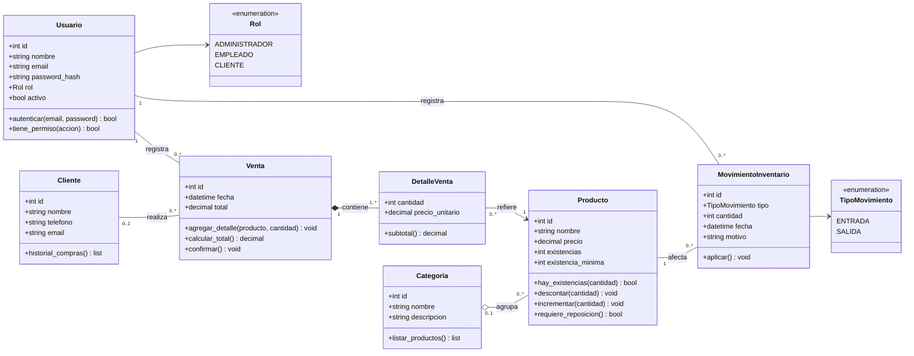
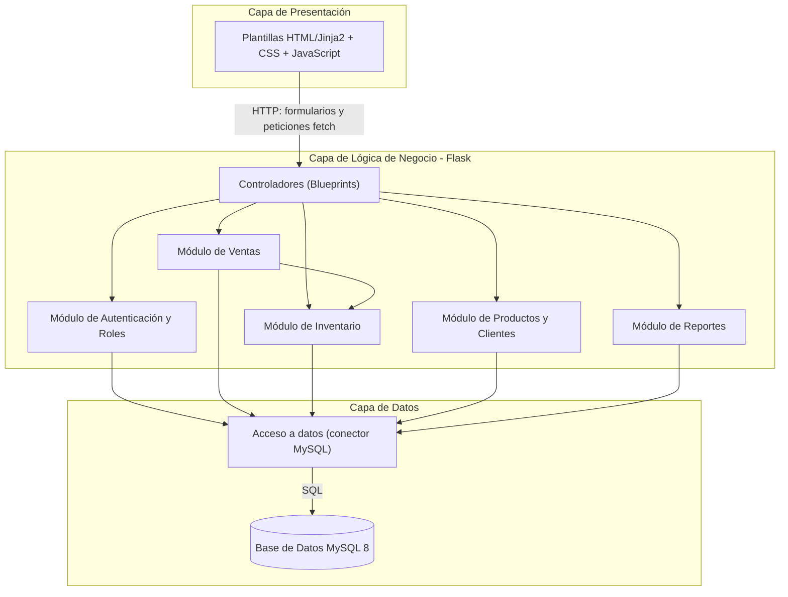
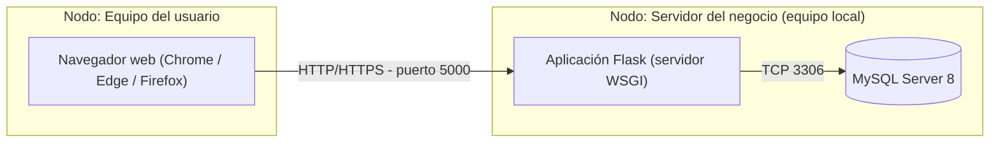

# Modelado Estructural y Diagramas de Arquitectura UML

**Proyecto:** Sistema de Gestión de Ventas e Inventario (SGVI)  
**Responsable:** Cristian Maldonado | **Fecha:** 2026-11-08

> El modelado de comportamiento (casos de uso y secuencia) se encuentra en las secciones 5 y 6 de `SRS_IEEE830.md`. Este documento presenta el modelado estructural, que se traduce en el esquema de `database/schema.sql`.

## 1. Diagrama de Clases UML (Sintaxis Mermaid)

### 1.1 Relaciones y multiplicidades

| Relación | Tipo | Multiplicidad | Justificación |
| :--- | :--- | :--- | :--- |
| Categoría – Producto | Agregación | 0..1 a 0..* | Un producto puede pertenecer a una categoría; si la categoría se elimina, el producto sigue existiendo. |
| Venta – DetalleVenta | Composición | 1 a 1..* | Una venta tiene al menos un detalle; los detalles no existen sin su venta. |
| DetalleVenta – Producto | Asociación dirigida | 0..* a 1 | Cada detalle refiere exactamente a un producto. |
| Cliente – Venta | Asociación | 0..1 a 0..* | Una venta puede registrarse sin cliente identificado (venta de mostrador). |
| Usuario – Venta | Asociación | 1 a 0..* | Toda venta la registra un usuario. |
| Producto – MovimientoInventario | Asociación | 1 a 0..* | Cada movimiento afecta a un producto y queda como bitácora. |

## 2. Diagrama de Componentes y Despliegue (Mermaid)

### 2.1 Componentes (arquitectura en tres capas)

### 2.2 Despliegue

El alcance inicial considera un despliegue local en un solo equipo del negocio (sin nube y sin múltiples sucursales, de acuerdo con las exclusiones de `SRS_IEEE830.md`).
