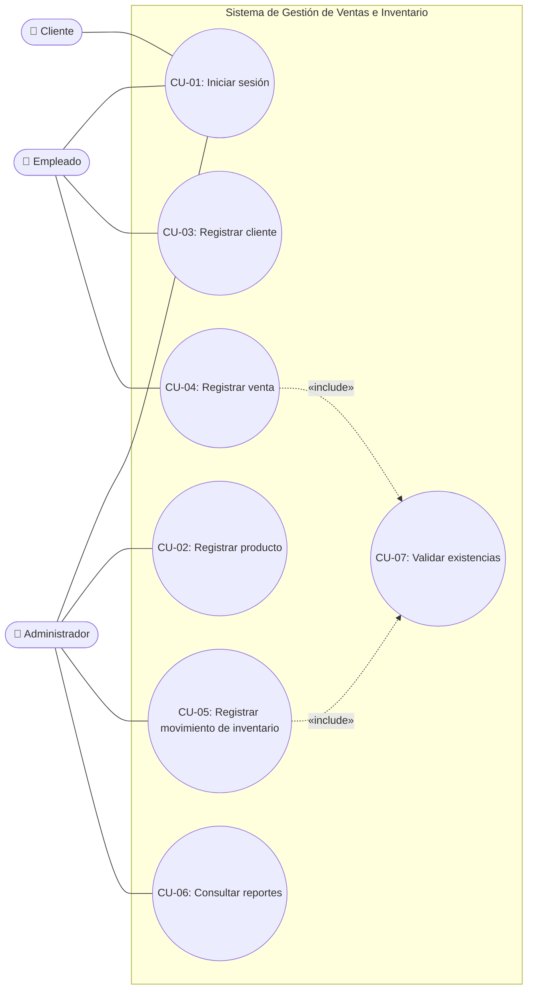
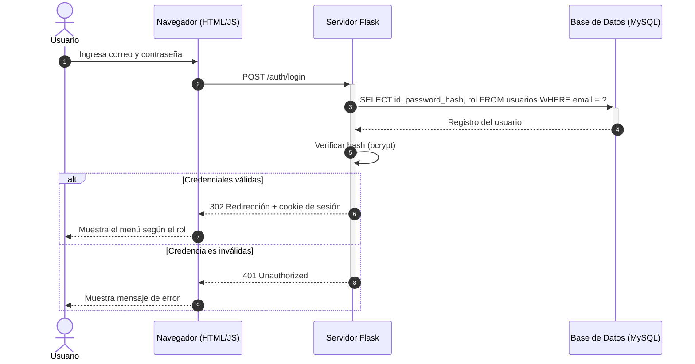
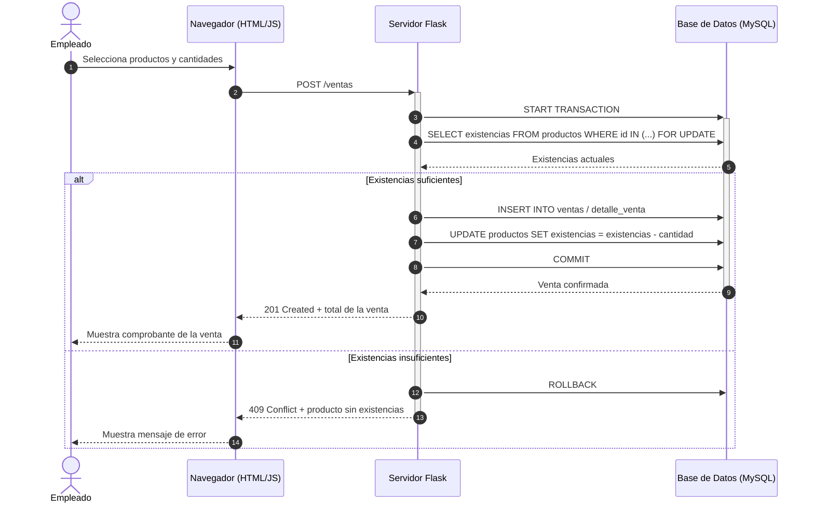

# Especificación de Requisitos de Software (SRS) - IEEE Std 830-1998

**Proyecto:** Sistema de Gestión de Ventas e Inventario (SGVI) | **Versión:** 1.2  
**Fecha:** 19 de octubre de 2026 (v1.2 con requisitos y casos de uso: 8 de noviembre de 2026)  
**Responsable:** Cristian Maldonado

## 1. Introducción

### 1.1 Propósito

El propósito de este documento es definir los requisitos de software del Sistema de Gestión de Ventas e Inventario (SGVI). Servirá como referencia para establecer el alcance del sistema, identificar sus funciones principales y orientar las etapas posteriores de diseño, desarrollo y pruebas.

Está dirigido al responsable del desarrollo del proyecto, al docente evaluador de la asignatura y a los usuarios del negocio que validarán las funciones del sistema.

La sección 1 presenta el propósito, el alcance y la terminología de la especificación. La sección 2 describe el contexto general del sistema, sus funciones, los usuarios, y las suposiciones y dependencias. La sección 3 especifica los requerimientos funcionales, la sección 4 los no funcionales (ISO/IEC 25010), la sección 5 el modelo de casos de uso y la sección 6 los diagramas de secuencia de los flujos principales.

### 1.2 Alcance del Sistema

El SGVI tiene como objetivo apoyar la administración de productos, clientes, ventas e inventario mediante un sistema centralizado. Se busca facilitar el registro y consulta de información, mantener un control de las existencias y generar reportes que apoyen la toma de decisiones.

**El sistema SÍ hará:**

- Permitir el inicio de sesión de los usuarios y controlar el acceso según su rol.
- Registrar, consultar y mantener productos y sus categorías.
- Registrar y consultar clientes.
- Registrar ventas, calcular su total y descontar las existencias correspondientes.
- Registrar entradas y salidas de inventario y consultar las existencias.
- Identificar productos con bajo inventario y productos con mayor demanda.
- Generar reportes básicos de ventas, productos e inventario.

**El sistema NO hará (exclusiones del alcance inicial):**

- Procesamiento de pagos en línea.
- Integración con bancos o sistemas financieros externos.
- Integración con plataformas externas de comercio electrónico.
- Facturación electrónica ni integración con servicios externos de facturación.
- Administración de múltiples sucursales.
- Aplicación móvil.
- Funciones de inteligencia artificial avanzada.

Estas funciones podrán evaluarse como ampliaciones futuras.

### 1.3 Definiciones, Acrónimos y Abreviaturas

| Término | Definición |
|---|---|
| SGVI | Sistema de Gestión de Ventas e Inventario. |
| SRS | Software Requirements Specification o Especificación de Requisitos de Software. |
| IEEE 830 | Estándar IEEE Std 830-1998 que describe una estructura para especificar requisitos de software. |
| Requisito funcional | Función o servicio que debe proporcionar el sistema. |
| Requisito no funcional | Condición de calidad o restricción que debe cumplir el sistema. |
| Inventario | Registro de productos y sus existencias disponibles. |
| Rol | Conjunto de permisos asignados a un tipo de usuario (Administrador, Empleado o Cliente). |
| HU | Historia de usuario. |
| Flask | Framework web para Python utilizado en la implementación. |
| MySQL | Sistema gestor de bases de datos relacionales utilizado por el sistema. |

**Referencias:** IEEE Std 830-1998, *IEEE Recommended Practice for Software Requirements Specifications*; `docs/CASO_ESTUDIO.md`; `HISTORIAS_USUARIO.md`; `PARADIGMA.md`; `CALIDAD.md`; `FACTIBILIDAD.md`; `CRONOGRAMA.md`.

## 2. Descripción General

### 2.1 Perspectiva del Producto

El SGVI es un producto independiente, no forma parte de un sistema mayor. Es una aplicación web orientada a centralizar las operaciones básicas de ventas e inventario de un negocio.

Se implementará con Python y el framework Flask, una interfaz web con HTML, CSS y JavaScript, y una base de datos MySQL. El repositorio de GitHub se utiliza para el control de versiones y la documentación del desarrollo. El sistema deberá mantener consistencia entre los productos registrados, las ventas realizadas y las existencias disponibles.

Restricciones del desarrollo:

- El desarrollo y la documentación se gestionan mediante Git y GitHub.
- Se siguen las convenciones de código y los criterios establecidos en `CALIDAD.md`.
- No se almacenan contraseñas, tokens ni credenciales en el repositorio.
- El desarrollo se realiza individualmente, por lo que la planificación considera el tiempo y la capacidad de una sola persona.

### 2.2 Funciones del Producto (Resumen Ejecutivo)

Las funciones principales, en orden de prioridad, son:

1. **Autenticación y control de acceso (Alta):** iniciar sesión y restringir las funciones según el rol del usuario.
2. **Gestión de productos (Alta):** registrar, consultar y mantener la información de productos y categorías.
3. **Gestión de ventas (Alta):** registrar operaciones de venta y asociarlas con los productos correspondientes.
4. **Control de inventario (Alta):** registrar entradas y salidas, consultar existencias y reflejar los cambios derivados de las ventas.
5. **Gestión de clientes (Media):** registrar y consultar la información de los clientes.
6. **Reportes (Media):** consultar ventas, productos más vendidos y productos con bajo inventario.

Las prioridades corresponden a las historias de usuario HU-01 a HU-06. Sus reglas de negocio y criterios de aceptación se detallan en `HISTORIAS_USUARIO.md`.

### 2.3 Características de los Usuarios

| Usuario | Responsabilidades | Nivel técnico | Permisos |
|---|---|---|---|
| Administrador | Gestión de usuarios, productos, categorías e inventario; consulta de reportes | Técnico alto | Acceso completo |
| Empleado | Registro de ventas, consulta de productos y registro de clientes | Medio | Lectura y escritura |
| Cliente | Consulta de información relacionada con sus operaciones | Básico | Solo lectura |

Se espera que los usuarios tengan conocimientos básicos de informática. La interfaz deberá utilizar etiquetas claras, formularios comprensibles y mensajes que permitan identificar errores de captura.

### 2.4 Suposiciones y Dependencias

- Se dispone de una computadora y conexión a internet para las actividades de desarrollo.
- GitHub estará disponible para alojar el repositorio y registrar los cambios.
- El entorno de ejecución contará con Python, Flask y un servidor MySQL disponibles.
- Los requisitos podrán ajustarse durante el análisis y diseño si se identifican necesidades adicionales.
- La implementación del control de inventario dependerá de definir las reglas para actualizar las existencias al registrar o modificar una venta.
- Los requisitos de seguridad, respaldo y recuperación deberán concretarse antes de establecer la solución técnica definitiva.

## 3. Requerimientos Funcionales (RF)

Cada requerimiento es atómico, verificable y rastreable hacia una historia de usuario (HU) y un caso de uso (CU).

| Código | Nombre del Requisito | Descripción | Prioridad | Actor Principal | Origen |
| :--- | :--- | :--- | :---: | :--- | :--- |
| RF-01 | Autenticación de usuarios | El sistema permitirá iniciar sesión con correo y contraseña, y rechazará credenciales inválidas con un mensaje de error. | Alta | Administrador / Empleado | HU-01, CU-01 |
| RF-02 | Control de acceso por rol | El sistema mostrará únicamente las funciones autorizadas para el rol del usuario (administrador, empleado o cliente). | Alta | Sistema | HU-01, CU-01 |
| RF-03 | Registro de productos | El sistema permitirá registrar productos con nombre, categoría, precio y existencias, y no guardará el producto si falta un dato obligatorio. | Alta | Administrador | HU-02, CU-02 |
| RF-04 | Registro de clientes | El sistema permitirá registrar clientes con nombre, teléfono y correo, indicando qué dato obligatorio falta. | Media | Empleado | HU-03, CU-03 |
| RF-05 | Registro de ventas | El sistema registrará ventas con uno o más productos, calculará el total y descontará las existencias en una sola transacción. | Alta | Empleado | HU-04, CU-04 |
| RF-06 | Validación de existencias | El sistema rechazará una venta o una salida de inventario cuando la cantidad solicitada supere las existencias disponibles. | Alta | Sistema | HU-04, HU-05, CU-07 |
| RF-07 | Movimientos de inventario | El sistema permitirá registrar entradas y salidas de productos, guardando la fecha, la cantidad, el tipo de movimiento y el usuario. | Alta | Administrador | HU-05, CU-05 |
| RF-08 | Reportes de ventas e inventario | El sistema generará reportes de ventas por periodo, productos más vendidos y productos con existencias por debajo del mínimo. | Media | Administrador | HU-06, CU-06 |

## 4. Requerimientos No Funcionales (RNF - ISO/IEC 25010)

| Código | Característica ISO/IEC 25010 | Requisito | Criterio de verificación |
| :--- | :--- | :--- | :--- |
| RNF-01 | Eficiencia de desempeño | Las consultas y el registro de una venta responderán en no más de 2.0 segundos con hasta 20 usuarios concurrentes. | Prueba de carga con 20 usuarios simulados. |
| RNF-02 | Seguridad | Las contraseñas se almacenarán con hashing bcrypt y, en despliegue, la comunicación se cifrará mediante HTTPS/TLS. Las sesiones expirarán tras 30 minutos de inactividad. | Revisión de la tabla `usuarios` y de la configuración del servidor. |
| RNF-03 | Mantenibilidad | El código cumplirá PEP 8 con 0 advertencias de Flake8, funciones de máximo 15 líneas y al menos 80% de cobertura de pruebas unitarias en los módulos de ventas e inventario. | Reporte de Flake8 y de cobertura. |
| RNF-04 | Fiabilidad | Ninguna venta podrá dejar existencias negativas; si falla un paso del registro de la venta, se revertirá toda la operación. | Pruebas de integración con fallos simulados. |
| RNF-05 | Usabilidad | Un empleado nuevo podrá registrar una venta en menos de 2 minutos después de una demostración; los errores de captura se indicarán junto al campo correspondiente. | Prueba de usabilidad con usuario. |
| RNF-06 | Compatibilidad | La interfaz funcionará en las versiones actuales de Chrome, Edge y Firefox en escritorio. | Pruebas en los tres navegadores. |

## 5. Diagrama de Casos de Uso y Descripción Tabular

> Mermaid no incluye un tipo de diagrama de casos de uso; se representa con un diagrama de flujo donde los actores son nodos externos y los casos de uso son elipses (nodos redondeados) dentro del límite del sistema.

### 5.1 Descripción tabular de los casos de uso

| ID | Caso de uso | Actor | Precondición | Flujo principal | Flujo alterno | Postcondición | Requisitos |
| :--- | :--- | :--- | :--- | :--- | :--- | :--- | :--- |
| CU-01 | Iniciar sesión | Administrador, Empleado, Cliente | El usuario está registrado y activo. | 1. Ingresa correo y contraseña. 2. El sistema valida las credenciales. 3. Muestra el menú según el rol. | Credenciales inválidas: muestra mensaje de error y no inicia sesión. | Sesión iniciada con los permisos del rol. | RF-01, RF-02 |
| CU-02 | Registrar producto | Administrador | Sesión de administrador. | 1. Captura nombre, categoría, precio y existencias. 2. El sistema valida los datos. 3. Guarda el producto. | Datos incompletos o inválidos: solicita completarlos y no guarda. | Producto disponible en el catálogo. | RF-03 |
| CU-03 | Registrar cliente | Empleado | Sesión de empleado o administrador. | 1. Captura los datos del cliente. 2. El sistema valida los campos obligatorios. 3. Guarda el cliente. | Faltan datos obligatorios: indica qué campos completar. | Cliente disponible para asociarlo a ventas. | RF-04 |
| CU-04 | Registrar venta | Empleado | Sesión iniciada; existen productos registrados. | 1. Selecciona productos y cantidades. 2. El sistema valida existencias. 3. Calcula el total. 4. Guarda la venta y descuenta existencias. | Existencias insuficientes: rechaza la venta e informa el producto afectado. | Venta registrada y existencias actualizadas. | RF-05, RF-06 |
| CU-05 | Registrar movimiento de inventario | Administrador | Sesión de administrador; el producto existe. | 1. Selecciona producto, tipo (entrada/salida) y cantidad. 2. El sistema valida la cantidad. 3. Actualiza existencias y guarda el movimiento. | Salida mayor a las existencias o cantidad ≤ 0: rechaza el movimiento. | Existencias y bitácora de movimientos actualizadas. | RF-06, RF-07 |
| CU-06 | Consultar reportes | Administrador | Sesión de administrador. | 1. Elige el tipo de reporte y el periodo. 2. El sistema consulta ventas e inventario. 3. Muestra el reporte. | Sin datos en el periodo: informa que no hay información. | Reporte mostrado en pantalla. | RF-08 |
| CU-07 | Validar existencias | Sistema (incluido en CU-04 y CU-05) | Existe el producto solicitado. | 1. Consulta las existencias actuales. 2. Compara con la cantidad solicitada. 3. Autoriza la operación. | Cantidad mayor a las existencias o ≤ 0: rechaza la operación. | Operación autorizada o rechazada. | RF-06 |

## 6. Diagramas de Secuencia UML

### 6.1 CU-01: Iniciar sesión

### 6.2 CU-04: Registrar venta

